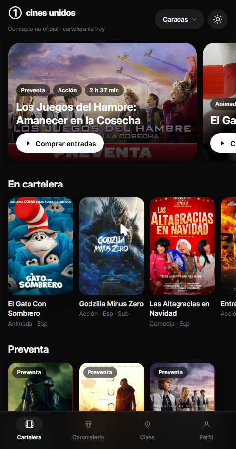
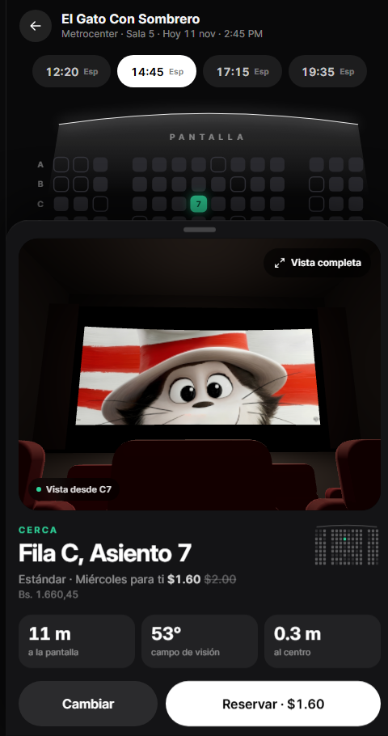
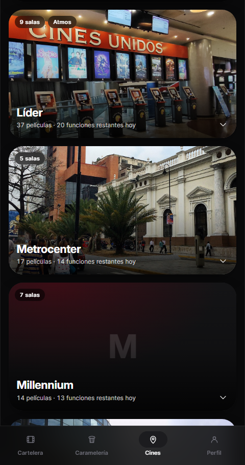
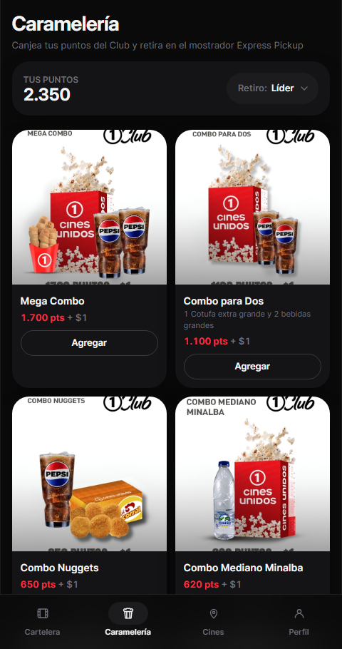
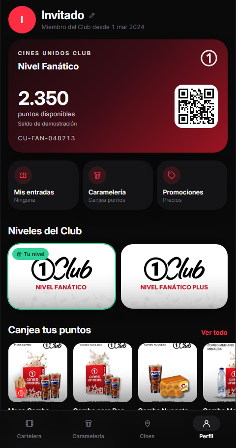

# Cines Unidos · Concepto

**Demo en vivo:** https://cines-unidos-concept.vercel.app (ábrelo en el teléfono)

Un rediseño no oficial de la app de Cines Unidos (Venezuela), hecho como ejercicio de producto y diseño. La idea central: **antes de comprar, tocas un asiento y ves la sala desde esa butaca**, con la distancia a la pantalla, el campo de visión y qué tan lejos del centro queda.

> Este repositorio es solo la vitrina del proyecto. El código fuente es privado.

## Qué hace

- **Cartelera real** de Cines Unidos para las 10 ciudades, con películas, preventas, eventos en vivo y próximos estrenos separados, agrupando Español, Subtitulada y Atmos como versiones de una misma película.
- **Película**: tráiler, sinopsis, elenco, días y funciones por cine.
- **Mapa de asientos** con pantalla curva, bloques, pasillos y reclinables.
- **Vista desde el asiento en 3D**: la sala se genera en tiempo real; la imagen de la película en pantalla, las butacas de adelante, luz de proyección. Se puede arrastrar para mirar alrededor o mover el teléfono con el giroscopio.
- **Precios reales** por cine y tipo de entrada (General, Lunes Popular, Miércoles para ti, Niño, Adulto mayor, Atmos), en dólares y bolívares, con la promo del día aplicada sola.
- **Compra simulada** y entrada con QR.
- **Perfil** con la tarjeta de Cines Unidos Club, niveles, preguntas frecuentes y ajustes.
- **Caramelería** con el catálogo canjeable por puntos y retiro Express Pickup.
- **Promociones y precios** publicados por el cine; **cines** con foto, dirección y cómo llegar.
- Tema claro y oscuro, instalable como PWA.

## Capturas

| Cartelera | Asiento y vista 3D | Vista completa |
| --- | --- | --- |
|  |  |  |

| Cines | Caramelería | Perfil |
| --- | --- | --- |
|  |  |  |

## De dónde salen los datos

Todo lo que se muestra viene de información pública de cinesunidos.com: cartelera, horarios, precios, promociones, cines y catálogo del Club. Lo que Cines Unidos no expone sin iniciar sesión (mapa de asientos real, saldo de puntos) se simula y se marca como demo en la interfaz. Las fotos de los cines son de Wikimedia Commons, con su autor y licencia visibles en la app.

Concepto inspirado en el trabajo de mejorar la aplicacion. Proyecto independiente, sin relación con Cines Unidos.

## Tecnología

Web móvil hecha con React, TypeScript, Tailwind y Three.js, desplegada en Vercel.
